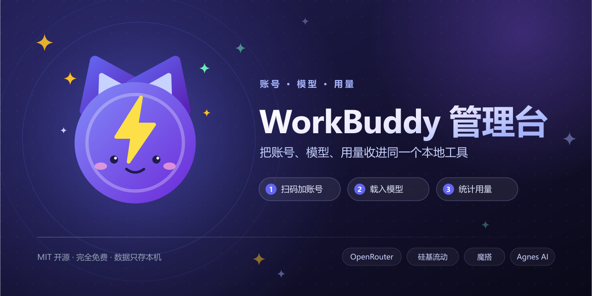

<p align="center">
  
</p>

# WorkBuddy 管理台

> 把 **WorkBuddy 账号管理**、**多平台免费模型**、**Token 用量统计**、**积分统计** 收进同一个本地工具。

这个仓库由两个工具融合而成：

| 能力 | 来源 |
| --- | --- |
| 多平台免费模型广场（OpenRouter / 硅基流动 / 魔搭 / Agnes AI 等） | [free-token](../free-token) |
| 账号管理、Token 统计、积分统计 | [workbuddy-switch](../workbuddy-switch-main) |

账号库 `~/.wb-switch/accounts.json` 与 workbuddy-switch **完全共享**，两个工具可以同时安装、随时切换使用，互不干扰。

---

## 快速开始

```bash
npm install          # 安装依赖
npm run build        # 构建前端
npm start            # 启动服务（默认 http://127.0.0.1:57891）
npm run app          # 以桌面窗口运行（Electron）
```

## 功能

| 页面 | 说明 |
| --- | --- |
| **账号管理** | 扫码添加（OAuth 设备码，二维码本地渲染、服务端常驻采集）、导入本机登录态、一键切换（自动备份 + 原子写入 + 失败回滚）、备注、删除；顶部标明当前登录态与 WorkBuddy 运行状态 |
| **免费模型广场** | 三个子页签合并在一个入口：**免费模型**（只看各平台免费模型，搜索 + 排序，一键写入 `models.json` 或导出给其他 agent）、**平台额度**（各平台 Key 的免费额度与余额）、**API Keys**（多 Key 轮换、测试、设为活跃）+ 模型列表缓存管理 |
| **反向代理** | 把 WorkBuddy 的官方对话能力**按四种主流协议**暴露给本机 agent：OpenAI Chat Completions（`/v1/chat/completions`）、Anthropic Messages（`/v1/messages`）、OpenAI Responses（`/v1/responses`）、Google Gemini 原生（`/v1beta/models/{model}:generateContent`）；账号池轮询、401 自动刷新 token 并换号、流式/非流式都支持（上游只收流式，非流式由代理聚合）；按协议族分组的接入示例（Claude Code / Codex CLI / Gemini CLI / Cherry Studio / Cline / Cursor / TRAE / 小米 MiMo / 豆包 等）、请求日志与连通性自检；默认关闭，需在页面显式开启 |
| **Token 统计** | 扫描本机会话日志（JSONL），统计请求数、输入/输出/缓存读写/思考 Token、缓存命中率、模型与项目排行、会话明细；**按档位（国内版 / 国际版）分别归档**，可选「全部档位」合并查看 |
| **积分统计** | 调用官方用量接口：可用剩余积分、按账号与档位汇总、逐请求明细（分页）、趋势与模型分布；接口不可达时回退本地离线预估 |
| **设置** | WorkBuddy 运行状态与重启、**每日签到**（自动巡检默认开启，可关闭；也可随时手动一键签到）、数据目录检测、**登录态与目录权限自检**、**登录态备份与恢复**、网络代理、通知历史、界面错误日志 |

## Token 统计口径

- `total = input + output + cacheWrite`，其中 `input` **已包含** cacheRead，因此不再重复累加 `cacheRead`。
- 真实日志中 cacheRead 只落在 `inputTokensDetails[].cached_tokens`，扁平别名（如 `cache_read_input_tokens`）恒为 0，已同时兼容两种结构。
- 档位数据根：国内版 `~/.workbuddy`（可在设置里覆盖），国际版 `~/.workbuddy-ai`。

## 桌面版（Windows / macOS）

管理台可以打包成免装 Node 的桌面应用：Electron 主进程里直接跑 Express 服务，窗口加载本地回环地址；**关闭窗口只是缩到系统托盘**，每日签到的自动巡检继续在后台运行，右键托盘图标可恢复窗口或真正退出。

```bash
npm run icons   # 生成 build/ 下的多平台图标（png / ico / icns / 托盘图）
npm run app:win # 打包 Windows 安装包（NSIS，release/*.exe）
npm run app:mac # 打包 macOS（release/*.dmg + *.zip；需在 macOS 上执行）
npm run app:dir # 只出免安装目录（release/<平台>-unpacked），本地验证用
```

- 打 tag（如 `v0.2.1`）推送到 GitHub 后，Actions 会同时构建 Windows 与 macOS 安装包并挂到 Release。
- **macOS 首次打开**：安装包未做 Apple 公证（identity 走 ad-hoc），首次需「右键 → 打开」或在「系统设置 → 隐私与安全性」里放行一次。
- 应用数据全部写在家目录（见下表），卸载程序不会动这些数据。

## 反向代理（给市面上的主流 agent 用 WorkBuddy 的额度）

开启后，管理台会在**自身端口**上提供四种主流协议的接口（不额外开端口）：

| 端点 | 协议 | 典型客户端 |
| --- | --- | --- |
| `POST /v1/chat/completions` | OpenAI Chat Completions | OpenAI SDK、Cherry Studio、Cline、Roo Code、Cursor、Continue、Aider、TRAE、小米 MiMo Code、豆包 MarsCode 等 |
| `POST /v1/messages` | Anthropic Messages | Claude Code、ZCode（Anthropic 模式）及其它 Anthropic 兼容客户端 |
| `POST /v1/responses` | OpenAI Responses | Codex CLI |
| `POST /v1beta/models/{model}:generateContent`<br>`POST /v1beta/models/{model}:streamGenerateContent` | Google Gemini 原生 | Gemini CLI、Gemini 原生 SDK |
| `GET /v1/models`、`GET /v1beta/models` | 模型清单（按客户端形状返回） | 全部 |

- **协议转换**：官方上游只认 OpenAI 协议、且**只接受流式**；四种入站协议都在 `server/proxy/` 里做双向翻译，非流式请求由代理本地聚合后回填。
- **风控净化**：上游会拦「system 文本里带别家 agent 系统提示词」的请求（`code 11128`）；代理出站前会把竞品指纹词中性化，用户消息不受影响。详见下文。
- **鉴权**：`Authorization: Bearer <Key>`、`x-api-key: <Key>`、`x-goog-api-key: <Key>`（或 `?key=`）三种都认 —— 分别对应 OpenAI 类 / Anthropic 类 / Gemini 类客户端各自的默认行为。Key 首次开启自动生成，可随时重新生成。
- **账号池**：默认用全部「带明文凭据」的账号按请求轮询；401/403 会先刷新 token 再换下一个账号。
- **档位隔离**：国内版走 `copilot.tencent.com`，国际版走 `www.workbuddy.ai`，绝不混档。
- **安全**：只监听 `127.0.0.1`，局域网不可见；`refresh_token` 只出现在官方 refresh 端点；请求日志只存内存、不含消息正文。
- **依赖**：代理由管理台进程提供，需保持管理台运行（桌面版关闭窗口后驻留托盘，不会中断）。

各客户端的配置片段在管理台「反向代理 → 接入示例」里**按协议族分组**列出、可直接复制。几个关键点：

```bash
# Claude Code（Anthropic 协议）
export ANTHROPIC_BASE_URL=http://127.0.0.1:57891/v1
export ANTHROPIC_AUTH_TOKEN=<页面上点「显示」复制的 Key>
```

```bash
# Gemini CLI：只填域名根，**不要带 /v1beta**（CLI 自己拼 /v1beta/models/{model}:...）
export GOOGLE_GEMINI_BASE_URL=http://127.0.0.1:57891
export GEMINI_API_KEY=<Key>
export GEMINI_MODEL=<模型 ID>
# 并在 ~/.gemini/settings.json 里显式指定 API Key 认证，否则会走 Google 账号登录：
# { "security": { "auth": { "selectedType": "gemini-api-key" } } }
```

> Gemini CLI 要求 HTTPS，但 `127.0.0.1` / localhost 例外，因此本机回环可直接用 http。

### 上游渠道风控（`code 11128`）与 system 文本净化

上游 `/v2/chat/completions` 有一道**渠道风控**：只放行 WorkBuddy 自家客户端的请求。
一旦在 system 级文本里认出别家 agent 的系统提示词，就回

```
400 {"code":11128,"msg":"Illegal API invocation from an unapproved channel"}
```

这跟客户端指纹头无关（同一组头走普通请求是通的），判的是**内容**。实测结论：

| 实验 | 结果 |
| --- | --- |
| 52,000 字中性文本 | 通过 → **与长度无关** |
| Codex `base_instructions` 前 184 字 | 通过 |
| 同上前 **185 字**（多一个句号） | **被拦** |
| 删掉三句里任意一句 / 打乱句序 / 句间插一个换行 | 通过 |
| 只把 `Codex CLI` 或只把 `OpenAI` 换成中性词 | 通过 |
| 整段转小写 | 仍被拦（大小写不敏感） |

⇒ 判据是**一段连续逐字文本**命中已知竞品系统提示词，不是关键词表、也不是长度门。

因此 `server/proxy/sanitize.mjs` 在出站前只做两件事：

1. 剔除客户端注入的内部元数据行（Claude Code 的 `x-anthropic-billing-header:` 等）；
2. 把竞品指纹词换成中性词（`Codex CLI` → `assistant CLI`、`OpenAI` → `the vendor`），
   按句首补大写，语义不变。

**只动 system 级文本**（Responses 的 `instructions`、Anthropic 的 `system`、
OpenAI 的 `role:"system"`、Gemini 的 `systemInstruction`），**用户消息一律原样透传** ——
用户正常问一句「OpenAI 是什么」不该被改写。

> 只有 `Codex` / `OpenAI` / `ChatGPT` 家族在词表里，因为只有它被实证触发；Claude Code、
> Gemini CLI 的系统提示词不会被改写。新增规则前请先二分验证，别凭猜加词。

协议级自动化测试（不联网、不碰真实账号，覆盖四种协议的转换、流式终止事件、路由鉴权
与风控净化）：

```bash
node scripts/test-proxy-protocols.mjs
```

## 隐私红线

- 绝不读取 / 返回 `providerData.reasoning`（思考内容）、`message.content`（消息正文）。
- 绝不读取 / 返回用量接口响应中的 `input` / `inputTrunc`（原文内容），只取 token 数与时间戳。
- 扫码登录的二维码由本机渲染（`qrcode` 库），验证链接含 state，不外传任何第三方。
- 账号 Token 在页面上只显示掩码；界面与本地服务仅监听 `127.0.0.1`。

## 数据位置

| 内容 | 路径 |
| --- | --- |
| 账号库（与 workbuddy-switch 共享） | `~/.wb-switch/accounts.json` |
| 登录态备份 | `~/.wb-switch/backups/` |
| WorkBuddy 登录态（国内版 / 国际版） | `%LOCALAPPDATA%\CodeBuddyExtension\Data\Public\auth\workbuddy-desktop.info` / `workbuddy-desktop-ai.info` |
| 积分快照（与 workbuddy-switch 共享，结构兼容） | `~/.wb-switch/credit_usage_snapshots.json` |
| 积分用量缓存（本工具私有） | `~/.wb-switch/credit_stats_cache.json` |
| 签到日志（本工具私有） | `~/.wb-switch/checkin_logs.json` |
| 工具配置（平台 Key / 代理 / 自动签到） | `~/.free-token/config.json` |
| 写入 WorkBuddy 的模型配置 | `~/.workbuddy/models.json`（国内版）/ `~/.workbuddy-ai/models.json`（国际版） |

> 与 workbuddy-switch 同目录共存时，**只有账号库、备份与积分快照是刻意共用的**；
> 缓存与日志各写各的文件，避免两边结构不同导致读取错乱。

## 技术栈

- **前端**：React 18 + TypeScript + Vite + Tailwind CSS + Recharts
- **后端**：Node.js（ESM）+ Express，仅监听回环地址，不暴露到局域网
- **桌面**：Electron + electron-builder（托盘常驻、单实例、开机自启动可选）

```
workbuddy-free-token-manage/
├── server/
│   ├── index.mjs            # Express 入口 + 路由
│   ├── proxy.mjs            # 出站代理（免费模型平台请求）
│   ├── proxy/               # 反向代理（多协议：OpenAI / Anthropic / Responses / Gemini）
│   │   ├── index.mjs        # 路由 + 账号池轮询 + 鉴权 + 管理 API
│   │   ├── wb.mjs           # WorkBuddy 官方上游客户端（风控头 / 刷新 token / SSE 聚合）
│   │   ├── anthropic.mjs    # Anthropic Messages ↔ OpenAI
│   │   ├── responses.mjs    # OpenAI Responses ↔ OpenAI
│   │   ├── gemini.mjs       # Google Gemini 原生 ↔ OpenAI
│   │   └── sanitize.mjs     # 出站 system 文本净化（上游渠道风控 code 11128）
│   ├── providers/           # 各平台适配（OpenRouter / 硅基流动 / 魔搭 / Agnes / Groq ...）
│   ├── stats/               # Token 日志扫描（worker 线程，支持多档位数据根）
│   ├── targets/workbuddy.mjs# WorkBuddy 数据目录检测、models.json 读写、重启
│   └── workbuddy/
│       ├── variant.mjs      # 国内版 / 国际版路径与常量
│       ├── accounts.mjs     # 账号存储（读写 / 备份 / 掩码）
│       ├── auth.mjs         # 登录态切换（原子写入 + 回读校验 + 回滚）
│       ├── oauth.mjs        # 扫码登录（服务端常驻轮询）
│       ├── credits.mjs      # 积分统计（官方接口 + 离线预估）
│       ├── checkin.mjs      # 每日签到
│       ├── backups.mjs      # 登录态备份管理
│       └── diagnostics.mjs  # 目录权限自检
├── src/
│   ├── App.tsx              # 侧栏导航与页面挂载
│   ├── components/ui.tsx    # 设计系统（Card / PageSection / Toolbar / StatCard ...）
│   └── pages/
│       ├── AccountsPage.tsx     # 账号管理（含扫码弹窗）
│       ├── PlatformPage.tsx     # 免费模型广场（三子页签）
│       ├── ProxyPage.tsx       # 反向代理（OpenAI 兼容）
│       ├── ModelsPage.tsx       # 模型广场
│       ├── QuotaPage.tsx        # 平台额度
│       ├── PlatformKeysPanel.tsx# API Keys
│       ├── StatsPage.tsx        # Token 统计
│       ├── CreditStatsPage.tsx  # 积分统计
│       └── SettingsPage.tsx     # 设置
└── electron/main.mjs        # 桌面壳（内嵌 Express + 窗口）
```
